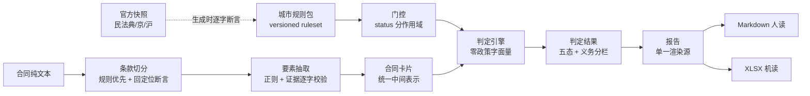

# 房屋租赁合同审计器（租客视角）

[](https://github.com/yuluo554/10-15-rental-contract-auditor/actions/workflows/ci.yml)

> **把分散在民法典与城市条例里的数值规则，做成可核验的合同体检；每条判定挂法条原文锚点。**
>
> 租客不是律师。押金上限、租金收取上限、备案期限、退还期限这些"硬数字"规则，
> 分散在《民法典》租赁编与各城市地方性法规里，普通人签合同前几乎没有逐条比对的手段。
> 通用大模型"问一句"得到的回答不挂法条原文、无版本化口径、不可复现——换个模型问，答案会漂移。

**本项目输出为辅助参考的合同体检结果，不构成法律意见。纯本地零上传。**

---

## 特性

- **城市差异包（versioned ruleset）**：京 / 沪两套地方规则 + 全国层（民法典），
  每条数值规则挂来源文件、条款号、**法条原文逐字引用**与核对状态。
- **法条原文锚点体系**：条款号由官方快照**机器推导**（不手抄），
  每条 `quote` 在生成时断言"逐字出现在官方快照中"。
- **判定语义不虚高**：五态判定（符合 / 不符合 / 不适用 / 无法判定 / 未评估），
  区分"没查出问题"与"没检查过"；主体未知时判"无法判定"而**不是**"不适用"。
- **义务类型分栏**：监管裁量条款（"政府**可以**采取价格干预"）独立成栏，
  绝不写成相对人的无条件义务。
- **可复现判定**：同规则包版本 + 同输入 = 同输出；报告人读（Markdown）+ 机读（XLSX）双轨，
  两种产物**逐字节可复现**（自写最小 OOXML writer，不引第三方保字节确定）。
- **离线零上传**：CLI 与桌面端均无出网调用，报告断网可开（无外链）。

## 架构



## 快速开始

```bash
# 需要 Python 3.8+（本机开发用 3.12）
python -m venv .venv
# Windows: .venv\Scripts\activate     POSIX: source .venv/bin/activate
python -m pip install -U pip
python -m pip install -e ".[dev,gui]"
```

> 安装行 `.[dev,gui]` 同时覆盖测试期依赖（pytest / PyYAML）与 GUI（PySide6）。
> **测试面 = 安装面**：测试套件真 import 的库都在这一条通路的 extras 里。

### 跑一次合同体检

```bash
# 单件体检（--city 取 北京 / 上海 / 全国）
python -m rca.cli check --input data/samples/demo-contract-bj.txt --city 北京

# 机读输出
python -m rca.cli check --input data/samples/demo-contract-bj.txt --city 北京 --json

# 导出报告（Markdown + XLSX 双轨，同输入逐字节一致）
python -m rca.cli report --input data/samples/demo-contract-bj.txt --city 北京 --out out/

# 查看规则包与门控状态
python -m rca.cli rules --city 北京

# 内置基准（三套件一键复跑）
python -m rca.cli bench

# 桌面界面（需 [gui]）
python -m rca.cli gui
```

### 退出码语义

| 退出码 | 含义 |
|---|---|
| 0 | 完成（无论是否检出不符合） |
| 1 | 检出**不符合**（判定类工具的既定语义，**不是失败**） |
| 2 | 输入不可用 / 用法错误 / 参数错误 |
| 3 | 缺可选依赖（如 GUI 的 PySide6） |

## 评测

基准三套件，零 API 依赖、离线可复跑（`python -m rca.cli bench`）：

| 套件 | 类型 | 指标 | 结果 |
|---|---|---|---|
| B1 | 样本驱动 | 要素抽取字段准确率 | 90/90 = 1.0000 |
| B2 | 样本驱动 | 端到端判定命中率（植入真值对账） | 17/17 = 1.0000，误报 0 |
| B3 | **规则驱动**（不读真值库） | 边界断言通过率 | 14/14 = 1.0000 |

**为什么分两层**：样本驱动证明"引擎在这些样本上对"，但**样本没覆盖的端点它证明不了**；
B3 从规则表推导端点做 ±精度邻域断言，专门补这个缺口。

**门槛随规则包下发**（数据非代码，见 `data/rules/ruleset-*.json` 的 `benchmark_thresholds`），
基准层只读、缺失即报配置错误——调门槛不改代码。

**每套件配可证伪探活**：注入缺陷（篡改真值 / 改规则边界）后基准必须报未达标，
防"基准全绿只是因为它什么都没查"。

## 目录

```
src/rca/
  cli.py           CLI 入口（退出码契约）
  model.py         统一中间表示（条款/卡片/判定）
  parser/          条款切分 + 要素抽取（规则优先）
  engine/          规则包门控 + 判定引擎 + 编排层
  report/          单一渲染源 + Markdown + 自写 OOXML writer
  benchmark/       三套件基准 + 真值对账单一实现源
  gui/             PySide6 界面（只消费引擎 API，零判定逻辑）
  packaging.py     打包白名单单一事实源
data/
  knowledge/raw/   官方全文快照（字节冻结，.gitattributes 标 -text）
  knowledge/MANIFEST.json  快照台账（URL/抓取日/sha256）
  rules/           城市规则包（生成器冻结产物，禁手改）
  samples/         合成合同样例 + 植入真值
tools/             抓取/生成/门禁/审计/打包脚本
plan/              计划文档 00–06 与跨会话交接快照
tests/             148 项测试（含全部守门）
```

## 数据来源

| 依据 | 渠道 | 状态 |
|---|---|---|
| 《中华人民共和国民法典》租赁编 | 最高人民法院官网 | ✅ 静态 HTML 全文 |
| 《北京市住房租赁条例》 | 北京市人大法规库 | ✅ 静态 HTML 全文 |
| 《上海市住房租赁条例》 | 上海市人民政府官网 | ✅ 静态 HTML 全文 |
| 《北京市住房租赁押金托管和租金监管暂行办法》 | 北京市住建委官网 | ✅ 静态 HTML 全文 |

详细查证记录、快照 sha256 与合成数据纪律见 [`data/README.md`](data/README.md)；
数据底座预检（HTTP 200 + 字节数 + 汉字数 + 结构计数）见 [`plan/02-数据底座说明.md`](plan/02-数据底座说明.md)。

## 已知环境问题

- **`py` 启动器会无视 venv**（Windows）：venv 段落一律用 `python -m pip ...`，
  不要用 `py -m pip ...`（后者装到系统 Python）。
- **老解释器上的重依赖要写上界**：PySide6 6.7+ 元数据要求 Python ≥3.9，
  故本项目锁定 `PySide6>=6.6,<6.7` 以兼容 3.8 通道。
- **打 GUI 的 PyInstaller 必须 ≥6**：5.x 扫描 PySide6 字节码会确定性崩溃
  （`Instruction object is not iterable`）。发布构建固定在装了 PyInstaller 6 的 3.12 通道。
- **`Path.write_text(newline=)` 是 Python 3.10+ 参数**：3.8 通道上会 TypeError；
  本项目生成器一律走 `write_bytes`（也是 EOL 门要求的形态）。
- **offscreen 平台拿不到系统字体**：中文会渲染成方块，GUI 启动时按环境变量
  推导字体目录显式注册（不写死盘符）。

## 限制（请先读这一节）

- **不构成法律意见**：输出为辅助参考的体检结果，正式口径以官方发布法规原文为准。
- **首期仅京/沪两市** + 全国层（民法典）。其他城市条例包属扩展项，
  须先完成该条例的原文直连查证后方可入包。
- **规则覆盖范围有限**：仅覆盖已在规则包中登记且"数值核对状态 = 已核对"的条款；
  未覆盖的规则**不会被静默忽略**——报告里"本次未启用的规则"一节显式列出。
- **解析面向中文合同的主要表述形态**：极端排版（图片型 PDF、扫描件）不在首期范围。
- **不接入在线法规数据库实时更新**：国家法律法规数据库（flk.npc.gov.cn）为
  JS 渲染 SPA，程序化直连实测不可行，本项目不依赖它。
- **首期不做 Word 回写**（扩展项）。

## 开发

```bash
python -m pytest -q                    # 全量测试（含全部守门）
python tools/gen_rulesets.py --check    # 规则包冻结校验
python tools/gen_samples.py --check     # 样例冻结校验
python tools/check_literals.py          # 零政策字面量门禁
python tools/audit_desensitize.py all   # 脱敏审计
```

方法论：本项目按 `ai-tool-project-sprint` 冲刺方法论组织——计划先行（`plan/`）、
数据先行（官方快照 + 冻结规则包）、判定语义不虚高、内置可证伪基准、脱敏发布。

## 许可

MIT，见 [LICENSE](LICENSE)。

## 免责声明

**本项目输出为辅助参考的合同体检结果，不构成法律意见。**
所有报告页面与导出文件均携带本声明。如对判定结果有异议，请以官方发布的法规原文为准。
